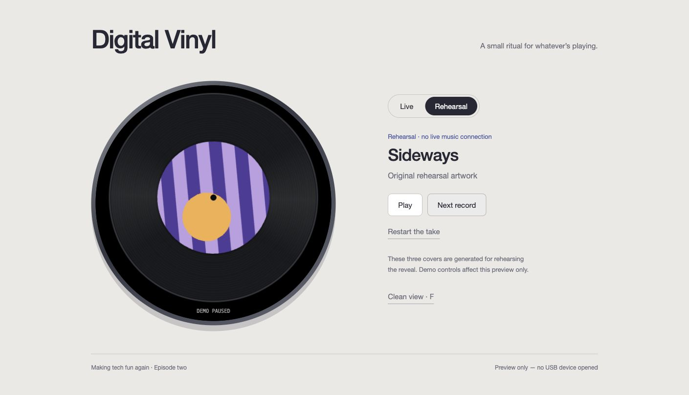

# Digital Vinyl

A little spinning record for whatever is playing on your Mac. Album artwork becomes
the center label; the record eases into motion on play and coasts to a stop on pause.
Built for **Waveshare ESP32-S3-Touch-AMOLED-1.75** (466 × 466, CO5300).



The music plays in **YouTube Music in Chrome on your Mac**. A small extension reads
one selected tab, a local Python bridge converts its artwork, and USB carries the
pixels and play/pause state to the board. The board is a display companion; it does
not stream or play audio. No Spotify account, cloud server, API key or Wi-Fi setup
is needed for this USB implementation.

**Code and software checks are ready. Physical display, USB timing, original-flash
backup/restore and the installed Chrome extension still need the first device run.**
The current player DOM was inspected in Chrome; this is not a claim that the entire
installed extension → physical board chain has been tested. See [validation](docs/VALIDATION.md).

## Start here

- [First setup, Chrome installation and daily use](docs/SETUP.md)
- [Board, battery and portability constraints](docs/HARDWARE.md)
- [Preserve the factory demo and switch projects](docs/RECOVERY.md)
- [Recording checklist and honest demo/live shots](docs/FILMING.md)
- [Data flow, serial protocol and source behavior](docs/ARCHITECTURE.md)
- [Credits and licenses](THIRD_PARTY_NOTICES.md)

## Preview without a board

Python 3.12 is the tested Python version. From this repository:

```sh
python3.12 -m venv .venv
.venv/bin/python -m pip install --require-hashes -r requirements.lock
.venv/bin/python bridge/server.py
```

Open **http://127.0.0.1:8766/**. Live starts in **WAITING**. Click **Rehearsal** for
three original generated covers, Play/Pause, Next record and Restart the take.
Press **F** for clean view and **Esc** to leave it. Rehearsal is visibly labeled
**DEMO**, including in clean view. Browser demo controls do not control music or
the physical board. You can also open `preview/index.html` directly for offline
rehearsal, but live mode needs the local server.

For real playback, prepare the extension and follow the installation steps:

```sh
.venv/bin/python tools/prepare_extension.py
```

The generated `local/chrome-extension/` contains a private pairing token. Load
that directory in Chrome, reload the music tab, then click **Connect this tab**
in the extension popup. Keep the generated directory private; share this source
repository instead.

## Build and check

```sh
python3 tools/project.py setup
make check
python3 tools/project.py build
```

Setup installs several GB of project-local tools and verifies pinned downloads.
`make check` additionally needs Node.js and a C++11 compiler. The Arduino CLI/core,
Waveshare commit and factory recovery image are pinned in `dependencies.json`;
Python dependencies are pinned with hashes in `requirements.lock`. No npm packages
are required. Setup, checks and builds do not open or flash a board.

Upload requires a verified original backup. Follow [recovery](docs/RECOVERY.md)
first; do not substitute a backup of your already-modified board for its factory
firmware. [Pocket Eyes](https://github.com/Erik-Cupsa/esp32-pocket-eyes) remains a
separate project, with the same original backup reusable for the same board.

## What is included

| Directory | Purpose |
| --- | --- |
| `firmware/DigitalVinyl` | Original record renderer, smooth motion, bounded serial receiver, board adapter |
| `extension` | Manifest V3 Chrome connector, player DOM adapter and source-selection popup |
| `bridge` | Loopback HTTP receiver, image conversion and acknowledged USB transfers |
| `preview` | Live desktop preview and explicit offline rehearsal |
| `tools` | Pinned setup/build, guarded upload/restore, two-read backup, extension preparation |
| `tests` | Native rendering/protocol, host/USB peer, extension routing and recovery checks |
| `docs` | Setup, architecture, hardware, filming and verification notes |

MIT for original code; vendor attribution and license copies are included.
